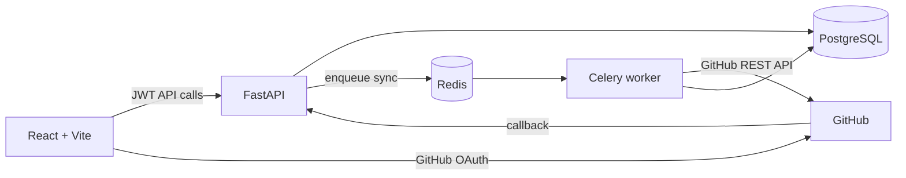

# RepoHub — Phase 1 MVP

RepoHub authenticates users with GitHub, stores their account and repositories in PostgreSQL, and presents a protected React dashboard. Repository imports run asynchronously through Celery and Redis.

## Phase 2 analytics

Each repository sync also imports commits, pull requests and their reviews, issues, releases, contributors, languages, and branch metadata. It calculates developer metrics (commit frequency, streak, estimated coding hours, weekend activity, and review score) plus per-repository merge, issue-resolution, activity, documentation, maintenance, and health scores.

The protected **Analytics** page includes metric cards, a 90-day commit activity chart, language distribution, and repository health. API endpoints are available at `/api/v1/analytics/developer`, `/repository`, `/team`, and `/history`.

## Phase 3 AI intelligence

Set `OPENAI_API_KEY` in `.env` and rebuild the backend to enable OpenAI-powered answers based only on synced analytics. The **AI** page supports career and repository questions and can download a PDF engineering report containing core metrics and AI recommendations. Endpoints: `POST /api/v1/ai/chat` and `POST /api/v1/ai/report`.

## Architecture



## Quick start

1. Copy `.env.example` to `.env` and set `GITHUB_CLIENT_ID`, `GITHUB_CLIENT_SECRET`, and a strong `JWT_SECRET_KEY`.
2. Create a GitHub OAuth App with callback URL `http://localhost:8000/api/v1/auth/github/callback`.
3. Run `docker compose up --build`.
4. Open [http://localhost:5173](http://localhost:5173). Swagger UI is at [http://localhost:8000/docs](http://localhost:8000/docs).

## Local development

Backend:

```bash
cd backend
python -m venv .venv && source .venv/bin/activate
pip install -r requirements.txt
alembic upgrade head
uvicorn app.main:app --reload
celery -A app.workers.celery_app worker --loglevel=INFO
pytest
```

Frontend:

```bash
cd frontend
npm install
npm run dev
```

For local SQLite-only backend experimentation, omit `DATABASE_URL`; Docker uses PostgreSQL by default. Redis is required for queued sync jobs.

## API

| Method | Endpoint | Purpose |
| --- | --- | --- |
| POST | `/api/v1/auth/github/login` | Gets GitHub authorization URL |
| GET | `/api/v1/auth/github/callback` | OAuth callback and frontend redirect |
| POST | `/api/v1/auth/refresh` | Exchanges a refresh token |
| POST | `/api/v1/auth/logout` | Client token discard endpoint |
| GET | `/api/v1/users/me` | Current user profile |
| GET | `/api/v1/repositories` | Current user's repositories |
| POST | `/api/v1/repositories/sync` | Queues an asynchronous import |

## Project layout

```text
backend/app/
  api/        HTTP routes and dependencies
  core/       settings and security primitives
  db/         SQLAlchemy setup
  models/     persistence models
  services/   GitHub API and sync persistence
  workers/    Celery application and tasks
frontend/src/
  api/ components/ pages/ store/
backend/alembic/  database migrations
backend/tests/    API and authentication tests
```

## Operational notes

- The callback puts short-lived access and long-lived refresh tokens in the browser redirect. For a production deployment, use HTTP-only secure cookies or an authorization-code handoff instead.
- GitHub access tokens are presently stored as text. Encrypt them at rest with a managed key in production.
- Logout is stateless: the client clears tokens. Implement a Redis token deny-list if immediate access-token revocation is required.
