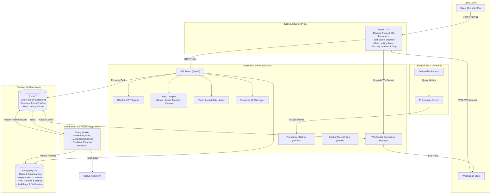

# RepoHub Enterprise

RepoHub is a modern, enterprise-grade GitHub Engineering Analytics and Team Intelligence SaaS platform. RepoHub collects data from GitHub repositories, ingests activity asynchronously via background Celery workers, computes engineering metrics, contributor rankings, and review bottlenecks, and delivers real-time updates via WebSockets and an interactive React dashboard.

It includes an AI Assistant powered by Google Gemini and OpenAI for engineering insights and automated PDF reports, alongside full Prometheus & Grafana observability, structured JSON logging, role-based access control (RBAC), rate limiting, audit logs, CI/CD automation, and production Nginx orchestration.

---

## Key Features

### 🏢 Multi-Tenant Organizations & RBAC
- Organization workspaces with custom slugs and branding
- Hierarchical Role-Based Access Control: `Owner`, `Admin`, `Member`, `Viewer`
- Repository association and team ownership mapping
- Complete security audit trail for administrative actions

### 📊 Team Analytics & Developer Intelligence
- **Contributor Rankings**: Impact score leaderboard weighted by commits, merged PRs, and submitted code reviews
- **Team Productivity**: 12-week velocity breakdown, sprint velocity scores, and weekly activity charts
- **Review Bottlenecks**: Time-to-first-review analysis, merge turnaround tracking, and open unreviewed PR queues
- **Developer Metrics**: Daily coding streak, estimated hours, review scores, and weekend activity percentages
- **Repository Health**: Merge rates, issue resolution efficiency, maintenance scores, and language distributions

### ⚡ Real-Time WebSockets & Live Progress
- Live repository sync progress stream (0–100%) with step-by-step UI toast updates
- Real-time notification push over WebSockets powered by Redis Pub/Sub
- Connection status badge with auto-reconnection and heartbeat ping/pong

### 🤖 AI Engineering Intelligence & PDF Reports
- Analytics-grounded AI chat assistant powered by Gemini / OpenAI
- Generates downloadable engineering reports in PDF format

### 📈 Monitoring & Observability
- **Prometheus**: Native `/metrics` scrape endpoint tracking HTTP requests, latency percentiles (P50/P95), active WebSockets, Celery task throughput, and audit events
- **Grafana**: Pre-provisioned dashboards with custom dark-themed SaaS monitoring panels
- **Structured Logging**: Production JSON log format with correlation IDs (`X-Request-ID`)
- **Multi-Tier Health Checks**: `/health` (component diagnostics), `/health/ready` (readiness), `/health/live` (liveness)

### 🔒 Enterprise Security & Governance
- Token-bucket rate limiting middleware with `X-RateLimit-*` response headers
- Security Headers: CSP, HSTS, X-Frame-Options, X-Content-Type-Options, Referrer-Policy
- Immutable audit logs tracking security and team management actions
- Strict Pydantic input validation and consistent error handling

---

## Tech Stack

| Layer | Technologies |
|---|---|
| **Frontend** | React 18, Vite, TypeScript, Tailwind CSS, TanStack React Query, Zustand, React Router |
| **Backend** | FastAPI, SQLAlchemy 2, Alembic, Pydantic v2, PyJWT, ReportLab |
| **Workers & Cache** | Celery, Redis 7 (Broker, Backend & Pub/Sub) |
| **Database** | PostgreSQL 16 (Relational & Analytical storage) |
| **Edge & Proxy** | Nginx 1.27 (Reverse Proxy, SSL, WebSocket Upgrade, Rate Limiting) |
| **Observability** | Prometheus, Grafana, Structured JSON Logger |
| **CI/CD** | GitHub Actions (Lint, Test, Build, Docker Image Validation) |

---

## Architecture



---

## Comprehensive Documentation

- 📐 [Architecture Documentation](docs/ARCHITECTURE.md)
- 🗄️ [Entity-Relationship (ER) Diagrams](docs/ER_DIAGRAMS.md)
- 📚 [REST & WebSocket API Reference](docs/API_REFERENCE.md)
- 🚀 [Production Deployment Guide](docs/DEPLOYMENT_GUIDE.md)
- 📈 [Scaling & High-Availability Guide](docs/SCALING_GUIDE.md)
- 💻 [Developer Handbook](docs/DEVELOPER_HANDBOOK.md)

---

## Quick Start

### 1. Run with Docker Compose (Production Setup)

```bash
docker compose -f docker-compose.prod.yml up --build -d
```

Services started:
- **Frontend & App Gateway**: `http://localhost`
- **FastAPI Backend**: `http://localhost/api/v1` (Swagger docs at `http://localhost/docs`)
- **Prometheus Metrics**: `http://localhost:9090`
- **Grafana Monitoring**: `http://localhost:3000` (User: `admin` / Password: `admin`)

### 2. Local Development

#### Backend
```bash
cd backend
python3 -m venv .venv
source .venv/bin/activate
pip install -r requirements.txt
alembic upgrade head
uvicorn app.main:app --reload --port 8000
```

#### Celery Worker
```bash
cd backend
source .venv/bin/activate
celery -A app.workers.celery_app worker --loglevel=INFO
```

#### Frontend
```bash
cd frontend
npm install
npm run dev
```

### 3. Automated Tests
```bash
cd backend
source .venv/bin/activate
pytest -v
```
