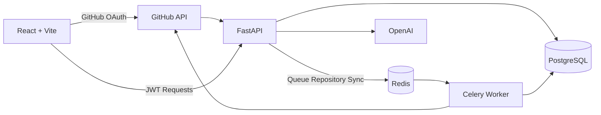

# RepoHub

RepoHub is a full-stack GitHub Developer Analytics platform that helps developers gain meaningful insights into their GitHub activity. Instead of simply displaying repository information, RepoHub collects data from GitHub, processes it in the background, calculates engineering metrics, and presents them through an interactive dashboard. It also includes an AI assistant that answers questions based on the synchronized analytics and generates downloadable engineering reports.

The project is built to demonstrate a production-style software architecture using FastAPI, React, PostgreSQL, Redis, Celery, Docker, and OpenAI.

---

# Features

## GitHub Authentication

- Secure GitHub OAuth login
- JWT-based authentication
- Protected user dashboard
- Automatic user profile synchronization

## Repository Synchronization

Users can import all of their GitHub repositories with a single click.

Repository synchronization runs asynchronously using Celery and Redis, allowing the application to remain responsive while importing large amounts of GitHub data.

The synchronization imports:

- Repositories
- Commits
- Pull Requests
- Pull Request Reviews
- Issues
- Releases
- Contributors
- Programming Languages
- Branches

---

# Developer Analytics

RepoHub processes imported GitHub data to generate useful engineering insights.

### Developer Metrics

- Commit Frequency
- Daily Coding Streak
- Estimated Coding Hours
- Weekend Activity
- Code Review Score

### Repository Metrics

- Repository Health Score
- Merge Efficiency
- Issue Resolution Score
- Documentation Score
- Maintenance Score
- Activity Score

The analytics dashboard includes:

- Summary metric cards
- 90-day commit activity chart
- Language distribution
- Repository health overview
- Historical activity

---

# AI Assistant

When an OpenAI API key is configured, RepoHub enables an AI assistant that answers questions using only the synchronized GitHub analytics.

Example questions:

- How consistent has my development been?
- Which repository needs the most maintenance?
- What are my strongest technical skills?
- Which project is most suitable for my portfolio?
- What should I improve before interviews?

The AI assistant can also generate a downloadable PDF engineering report containing:

- Developer statistics
- Repository summaries
- Engineering insights
- Improvement recommendations

---

# Tech Stack

## Frontend

- React
- Vite
- TypeScript
- React Router
- Axios

## Backend

- FastAPI
- SQLAlchemy
- Alembic
- PostgreSQL
- Redis
- Celery
- JWT Authentication

## External Services

- GitHub REST API
- OpenAI API

---

# Architecture



---

# How It Works

1. The user signs in using GitHub OAuth.
2. FastAPI authenticates the user and generates JWT tokens.
3. The user requests a repository synchronization.
4. A Celery worker imports GitHub data in the background.
5. Repository information is stored in PostgreSQL.
6. Analytics are calculated from the imported data.
7. The React dashboard visualizes the metrics.
8. The AI assistant answers questions based on synchronized analytics.

---

# API Endpoints

| Method | Endpoint | Description |
|---------|----------|-------------|
| POST | `/api/v1/auth/github/login` | Start GitHub OAuth |
| GET | `/api/v1/auth/github/callback` | GitHub OAuth callback |
| POST | `/api/v1/auth/refresh` | Refresh access token |
| POST | `/api/v1/auth/logout` | Logout |
| GET | `/api/v1/users/me` | Current authenticated user |
| GET | `/api/v1/repositories` | List user repositories |
| POST | `/api/v1/repositories/sync` | Queue repository synchronization |
| GET | `/api/v1/analytics/developer` | Developer analytics |
| GET | `/api/v1/analytics/repository` | Repository analytics |
| GET | `/api/v1/analytics/team` | Team analytics |
| GET | `/api/v1/analytics/history` | Historical analytics |
| POST | `/api/v1/ai/chat` | AI-powered analytics assistant |
| POST | `/api/v1/ai/report` | Generate engineering report |

---

# Getting Started

## Prerequisites

- Docker
- Docker Compose
- GitHub OAuth Application
- (Optional) OpenAI API Key

---

## Environment Variables

Copy the example environment file.

```bash
cp .env.example .env
```

Configure the following variables:

```env
GITHUB_CLIENT_ID=
GITHUB_CLIENT_SECRET=

JWT_SECRET_KEY=

DATABASE_URL=

REDIS_URL=

OPENAI_API_KEY=
```

---

## GitHub OAuth Setup

Create a GitHub OAuth Application and configure the callback URL:

```
http://localhost:8000/api/v1/auth/github/callback
```

---

## Running with Docker

Build and start the application.

```bash
docker compose up --build
```

Frontend:

```
http://localhost:5173
```

Backend:

```
http://localhost:8000
```

Swagger API Documentation:

```
http://localhost:8000/docs
```

---

# Local Development

## Backend

```bash
cd backend

python -m venv .venv

source .venv/bin/activate

pip install -r requirements.txt

alembic upgrade head

uvicorn app.main:app --reload

celery -A app.workers.celery_app worker --loglevel=INFO

pytest
```

## Frontend

```bash
cd frontend

npm install

npm run dev
```

---

# Project Structure

```
backend/
│
├── app/
│   ├── api/
│   ├── core/
│   ├── db/
│   ├── models/
│   ├── services/
│   ├── workers/
│   └── main.py
│
├── alembic/
├── tests/
└── requirements.txt

frontend/
│
├── src/
│   ├── api/
│   ├── components/
│   ├── pages/
│   ├── store/
│   └── App.tsx
│
└── package.json
```

---

# Security Considerations

This project is intended for learning and portfolio purposes.

For a production deployment, consider implementing:

- HTTP-only secure cookies for JWT storage
- Encryption of GitHub access tokens
- Token revocation and blacklisting
- HTTPS
- Rate limiting
- Secret management services
- Monitoring and logging

---

# Future Enhancements

- GitHub GraphQL API integration
- Organization analytics
- Team collaboration metrics
- Email reports
- GitHub Webhook support
- CI/CD analytics
- Code quality insights
- Multi-provider support (GitLab, Bitbucket)
- Advanced AI recommendations

---

# Why RepoHub?

RepoHub was built to demonstrate modern full-stack software engineering practices beyond a traditional CRUD application. It combines secure authentication, asynchronous background processing, relational databases, analytics, interactive data visualization, AI integration, and scalable backend architecture into a single project.

The project showcases practical experience with technologies and patterns commonly used in production systems while providing developers with valuable insights into their GitHub activity.