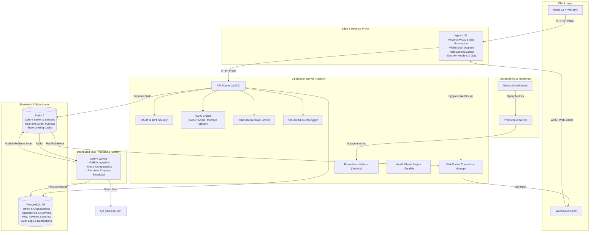
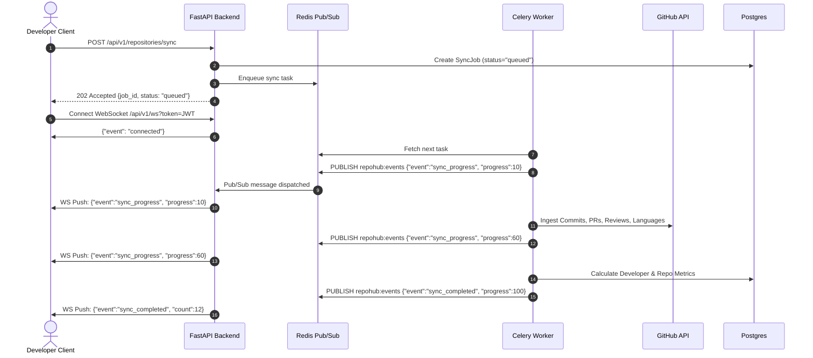

# RepoHub Architecture Documentation

RepoHub is a full-stack, multi-tenant engineering intelligence and developer analytics SaaS platform. It ingests repository activity from the GitHub REST/GraphQL APIs, processes commit and pull request data asynchronously using background Celery workers, computes advanced productivity and repository health metrics, and visualizes insights via a high-performance React SPA.

---

## High-Level System Architecture

---

## Core Subsystems

### 1. Multi-Tenant Organization & RBAC Architecture
Organizations provide multi-tenant isolation for teams.
- **Roles**:
  - `owner`: Full administrative privileges, billing, organization deletion, member management.
  - `admin`: Member invitation, role updates, repository linking/unlinking, audit log inspection.
  - `member`: Link personal repositories to organization, view team dashboards, view contributor rankings.
  - `viewer`: Read-only access to team productivity and metrics.
- **Resource Ownership**:
  - Repositories can be associated with organizations via the `organization_repositories` junction table while retaining user ownership.

### 2. Real-Time WebSocket Pub/Sub Flow

### 3. Observability Architecture
- **Metrics**: Standard Prometheus exposition format via `/metrics`.
  - HTTP request volume, status codes, latency histograms.
  - Celery task throughput and execution times.
  - Active WebSocket client count.
  - Security audit event counters.
- **Logging**: Structured JSON single-line logs format matching cloud log collector specifications (Loki, Datadog, ELK).
- **Health Probes**: Multi-tier health endpoints:
  - `/health`: Deep component diagnostic (DB ping, Redis ping, Celery node status).
  - `/health/ready`: Readiness probe for load balancers.
  - `/health/live`: Liveness probe for orchestrators (Kubernetes/Docker).
