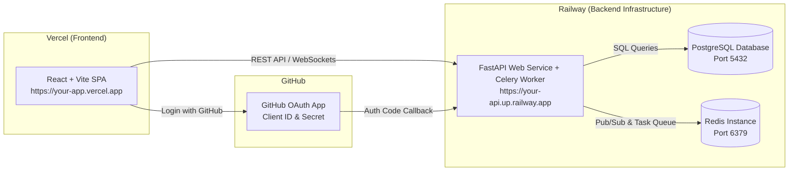

# Deploying RepoHub: Backend on Railway & Frontend on Vercel

This guide provides a comprehensive, step-by-step manual for deploying the **RepoHub** backend (FastAPI, Celery, PostgreSQL, Redis) on **Railway** and the frontend (React, Vite, Tailwind CSS) on **Vercel**.

---

## Architecture Overview



---

## Step 1: Create a GitHub OAuth App

1. Go to [GitHub Developer Settings > OAuth Apps](https://github.com/settings/developers).
2. Click **New OAuth App**.
3. Fill in the fields:
   - **Application name**: `RepoHub` (or your chosen name)
   - **Homepage URL**: `https://your-app.vercel.app` *(you can use `http://localhost:5173` temporarily and update once Vercel is deployed)*
   - **Authorization callback URL**: `https://your-api.up.railway.app/api/v1/auth/github/callback` *(replace with your Railway backend domain)*
4. Click **Register application**.
5. Copy the **Client ID** and click **Generate a new client secret** to obtain your **Client Secret**. Keep these handy.

---

## Step 2: Deploy Backend to Railway

### 1. Create a New Project on Railway
1. Go to [railway.app](https://railway.app) and sign in (using GitHub).
2. Click **New Project** > **Provision PostgreSQL**.
3. In the same project canvas, click **+ Create** / **Add Service** > **Database** > **Redis**.

### 2. Add the Backend Web Service
1. Click **+ Create** / **Add Service** > **GitHub Repo**.
2. Select your repository (`RepoHub-GitInsight-AI` or your fork).
3. Select the repository service and go to **Settings**:
   - **Root Directory**: Leave empty or set to `/` (Railway will read `railway.json` in the root).
   - Alternatively, if deploying only the backend subfolder, set Root Directory to `backend`.
4. Go to **Variables** (Environment Variables) and configure:

| Variable Name | Value / Description |
| :--- | :--- |
| `DATABASE_URL` | `${{Postgres.DATABASE_URL}}` *(Reference PostgreSQL service)* |
| `REDIS_URL` | `${{Redis.REDIS_URL}}` *(Reference Redis service)* |
| `JWT_SECRET_KEY` | *Generate a secure 32+ character random string* |
| `JWT_ACCESS_TOKEN_EXPIRE_MINUTES` | `15` |
| `JWT_REFRESH_TOKEN_EXPIRE_DAYS` | `30` |
| `GITHUB_CLIENT_ID` | *Your GitHub OAuth Client ID from Step 1* |
| `GITHUB_CLIENT_SECRET` | *Your GitHub OAuth Client Secret from Step 1* |
| `GITHUB_REDIRECT_URI` | `https://${{RAILWAY_PUBLIC_DOMAIN}}/api/v1/auth/github/callback` |
| `FRONTEND_URL` | `https://your-app.vercel.app` *(Your Vercel URL)* |
| `GEMINI_API_KEY` | *Your Google Gemini API Key* |
| `GEMINI_MODEL` | `gemini-3.5-flash` |

> [!TIP]
> Railway provides variable reference shortcuts! Typing `${{` allows you to pick `Postgres.DATABASE_URL` and `Redis.REDIS_URL` directly.

### 3. Generate a Public Domain
1. In the backend service settings, scroll to **Networking** / **Public Networking**.
2. Click **Generate Domain** (e.g. `repohub-backend-production.up.railway.app`).
3. Note down this domain: `https://<your-backend-domain>.up.railway.app`.

### 4. Deploy & Verify Backend
1. Railway will automatically build the container and execute `start-railway.sh` (which runs database migrations, starts the Celery worker, and launches Uvicorn).
2. Visit `https://<your-backend-domain>.up.railway.app/health` in your browser. You should receive:
   ```json
   {
     "status": "healthy",
     "version": "1.0.0",
     "checks": {
       "database": "ok",
       "redis": "ok",
       "background_workers": "ok"
     }
   }
   ```
3. Visit `https://<your-backend-domain>.up.railway.app/docs` to view the interactive OpenAPI documentation.

---

## Step 3: Deploy Frontend to Vercel

### 1. Import Repository on Vercel
1. Go to [vercel.com](https://vercel.com) and log in with your GitHub account.
2. Click **Add New...** > **Project**.
3. Find and select your repository.

### 2. Configure Build & Project Settings
In the configuration screen:
- **Framework Preset**: `Vite`
- **Root Directory**: Click `Edit` and select `frontend`
- **Build Command**: `npm run build` (or leave default)
- **Output Directory**: `dist` (or leave default)
- **Install Command**: `npm install` (or leave default)

### 3. Add Environment Variables
Under the **Environment Variables** section, add:

| Name | Value |
| :--- | :--- |
| `VITE_API_URL` | `https://<your-backend-domain>.up.railway.app` |

*(Do **not** add `/api/v1` or trailing slashes; the frontend client automatically normalizes endpoints and WebSocket connections).*

### 4. Deploy
1. Click **Deploy**.
2. Vercel will build the frontend and generate a deployment URL (e.g. `https://repohub.vercel.app`).

---

## Step 4: Finalize Connections

Now that both backend and frontend domains are active:

1. **Update GitHub OAuth App**:
   - Go to [GitHub Developer Settings](https://github.com/settings/developers) > your app.
   - Set **Homepage URL**: `https://your-app.vercel.app`
   - Set **Authorization callback URL**: `https://<your-backend-domain>.up.railway.app/api/v1/auth/github/callback`
2. **Update Railway Backend Environment Variables**:
   - In Railway > Backend Service > **Variables**:
   - Set `FRONTEND_URL` = `https://your-app.vercel.app`
   - Set `GITHUB_REDIRECT_URI` = `https://<your-backend-domain>.up.railway.app/api/v1/auth/github/callback`
   - Railway will automatically redeploy the backend with the new variables.

---

## Verification & Sanity Checklist

- [ ] **Backend Health**: `curl https://<your-backend-domain>.up.railway.app/health` returns status `healthy`.
- [ ] **Frontend Loading**: Open `https://your-app.vercel.app` in your browser.
- [ ] **SPA Route Refresh**: Navigate to `/login` or `/repositories` and reload the page (F5) — page loads without 404.
- [ ] **GitHub OAuth Flow**: Click **Login with GitHub**; authenticate and confirm you are redirected back to the dashboard.
- [ ] **WebSocket Sync**: Trigger a repository sync and verify real-time toast notifications appear via `wss://<your-backend-domain>.up.railway.app/api/v1/ws`.
- [ ] **AI Insights**: Generate repository or developer AI summaries via Google Gemini.

---

## Troubleshooting & Common Questions

### 1. `CORS error: No 'Access-Control-Allow-Origin' header`
- Ensure `FRONTEND_URL` in Railway is set exactly to your Vercel URL (e.g. `https://repohub.vercel.app`).
- The backend's CORS regex also automatically allows all `https://*.vercel.app` domains, including preview deployments.

### 2. Database Connection Error on Railway
- Ensure `DATABASE_URL` is set to `${{Postgres.DATABASE_URL}}`.
- The application automatically normalizes `postgres://` URLs to `postgresql+psycopg://` for SQLAlchemy 2.0 and Alembic.

### 3. Celery Tasks Not Processing
- Verify that Redis service is active in Railway and `REDIS_URL` is configured.
- The `start-railway.sh` script starts both Celery worker and FastAPI in the same container. For heavy workloads, you can spin up a dedicated worker service on Railway using the command: `celery -A app.workers.celery_app worker --loglevel=INFO`.

### 4. 404 on Vercel Page Refresh
- Make sure `frontend/vercel.json` exists with the rewrite rule to `/index.html`.
